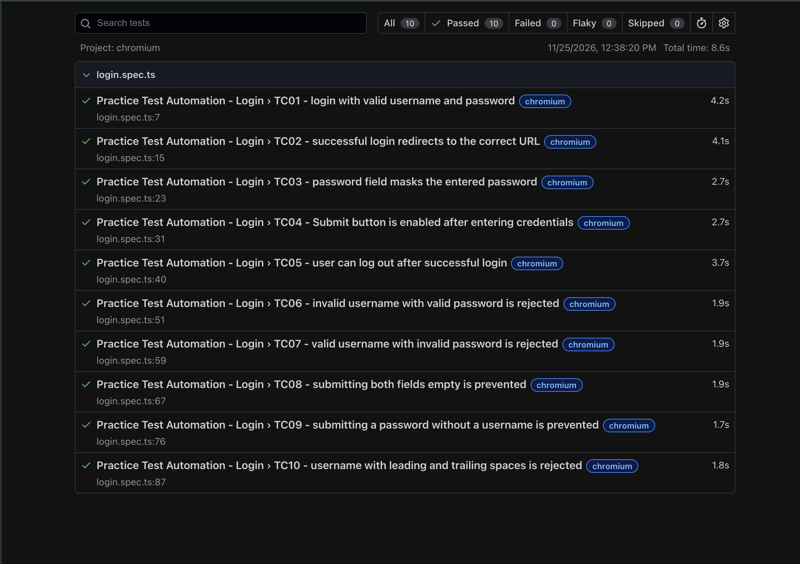

# Playwright Login Assignment

This project automates the login functionality of the Practice Test Automation website using Playwright with TypeScript.

The framework follows the Page Object Model (POM) design pattern and uses custom Playwright fixtures for reusable page initialization

### Application under test

- Login URL: `https://practicetestautomation.com/practice-test-login/`

## Tech Stack 
- Playwright
- TypeScript
- Node.js
- Playwright Test Runner

## Architecture

```text
playwright-login-assignment/
├── fixtures/
│   └── test-fixtures.ts       # Custom fixture that creates LoginPage and opens the login page
├── pages/
│   └── LoginPage.ts           # Page Object Model with locators and login actions
├── test-cases/
│   └── login-test-cases.xlsx  # List of functional test cases
├── test-data/
│   └── credentials.ts         # Valid and invalid test credentials
├── test-evidence/
│   └── test-result.png        # run summary of all the tests
├── tests/
│   └── login.spec.ts          # Login, logout, validation, and credential scenarios
├── playwright.config.ts       # Test directory, browser, base URL, retries, traces, and reports
├── tsconfig.json              # TypeScript compiler settings
└── package.json               # npm scripts and dependencies
```

## Design Approach 

- Page Object Model: Separates page locators, actions and assertions from test scenarios.
- Custom Fixtures: Initializes and provides reusable page objects to test cases.
- Test Data Management: Maintains test credentials separately from test scripts.
- Assertions: Uses Playwright's built-in assertions to validate application behavior.

### Test flow

1. `login.spec.ts` requests the `loginPage` fixture.
2. `test-fixtures.ts` creates a `LoginPage` instance for the active Playwright `page`.
3. The fixture navigates to `/practice-test-login/`.
4. `LoginPage` exposes locators and reusable actions such as `login()`, `logout()`, and error assertions.
5. Each test uses web-first Playwright assertions to verify the result.


## Functional Test coverage

The suite contains five positive and five negative scenarios:

### Positive

| ID | Scenario |
| --- | --- |
| TC01 | Login with valid credentials |
| TC02 | Verify successful-login redirect |
| TC03 | Verify password masking |
| TC04 | Verify submit button is enabled after credentials are entered |
| TC05 | Log out after successful login |

### Negative

| ID | Scenario |
| --- | --- |
| TC06 | Reject an invalid username |
| TC07 | Reject an invalid password |
| TC08 | Prevent submission with both fields empty |
| TC09 | Prevent submission with only a password |
| TC10 | Reject a username with leading and trailing spaces |

## Prerequisites

- Node.js 18 or later
- npm
- Internet access to the application under test

## Installation & Setup

Clone the repository:

```bash
git clone https://github.com/Utkarsh630/playwright-login-assignment.git
cd playwright-login-assignment
```

Install dependencies:

```bash
npm install
```

Install Playwright browsers:

```bash
npx playwright install
```

## Running the tests

Run all tests:

```bash
npm test
```

Run tests in headed mode:

```bash
npm run test:headed
```

Run tests with the Playwright UI:

```bash
npm run test:ui
```

Run a specific test file:

```bash
npx playwright test tests/login.spec.ts
```

## Test Reports and artifacts

After test execution, open the HTML report:

```bash
npm run report
```

The report displays test execution status, passed tests, failed tests and execution details.

Additional debugging artifacts are configured:

Screenshots: Captured on test failure.

Traces: Retained on failure.

Videos: Retained on failure.

Generated test reports and artifacts are stored in the Playwright output directories.

### Test Execution Evidence

The following screenshots show the Playwright test execution results.

